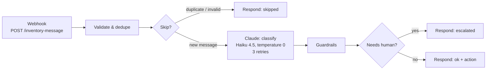

# n8n-inventory-triage

An **n8n workflow** that turns free-text WhatsApp messages from field crews into structured inventory actions
using **Claude** — with guardrails so the model can't invent quantities, products or actions.

> *"Se gastaron 10 cascos en la faena norte"* →
> `{ "intent": "stock_movement", "sku": "EPP-CASCO", "type": "out", "quantity": 10 }`

It is the "intake" side of the patterns I run in production at [Patagon](https://patagoninventario.cl), and it
pairs with [patagon-inventory-mcp](https://github.com/Sr-Stark08/patagon-inventory-mcp), which executes the actions.
Sample catalog only.

## Flow



## Guardrails

The model **proposes**; code **decides**. A message is escalated to a human when:

| Check | Why |
|---|---|
| Output is not valid JSON | Never act on something you can't parse |
| Unknown intent or missing confidence | Schema validation of the model output |
| Confidence below 0.7, intent `other`, or model asks for a human | Ambiguity goes to people, not to guesses |
| SKU not in the catalog | The model can't invent products |
| Quantity not a positive integer, or **not literally present in the message** | The model can't invent numbers (`12` is rejected if the user wrote `120`) |

Plus **idempotency**: each `message_id` is processed once. A redelivered WhatsApp webhook returns `duplicate`
instead of creating a second movement. The outcome is recorded only *after* processing, so a failed run can be
retried safely. Claude calls retry up to 3 times on transient errors.

## Setup

1. Run n8n (`npx n8n`) and open `http://localhost:5678`.
2. **Workflows → Import from file** → select `workflow.json`.
3. Open **Claude: classify** → Credential → **Create new → Header Auth**:
   - Name: `x-api-key`
   - Value: your Anthropic API key
4. Click **Execute workflow**, then send a test message to the test URL.

### Test messages (PowerShell)

```powershell
$url = "http://localhost:5678/webhook-test/inventory-message"
$body = @{ message_id = "wa-001"; from = "+56900000000"; text = "Se gastaron 10 cascos en la faena norte" } | ConvertTo-Json
Invoke-RestMethod -Uri $url -Method Post -Body $body -ContentType "application/json"
```

### Test messages (bash)

```bash
curl -X POST http://localhost:5678/webhook-test/inventory-message \
  -H "Content-Type: application/json" \
  -d '{"message_id":"wa-001","text":"Se gastaron 10 cascos en la faena norte"}'
```

Try also: `"cuántos guantes quedan"` (query), `"saquen 3 martillos"` (unknown SKU → escalated),
`"quiero hablar con alguien"` (→ escalated), and resending the same `message_id` (→ duplicate).

> Deduplication uses n8n workflow static data, which persists only for **production** executions
> (published workflow, `/webhook/` URL). In manual test runs every call starts fresh.

## Tests

The logic inside both Code nodes lives in `nodes/` and is tested without n8n or an API key:

```bash
node tests/nodes.test.mjs
```

10 cases: happy path, duplicate, invented quantity, partial number match, unknown SKU, invalid JSON,
low confidence, human request, stock query, missing `message_id`.

## Structure

```
workflow.json          # importable n8n workflow
nodes/validate.js      # Code node: input validation + dedupe
nodes/guardrails.js    # Code node: parse and validate Claude's output
tests/nodes.test.mjs   # tests for both Code nodes
```

## Author

**Jorge Fraile Pereira** — AI Agent Developer, founder of [Patagon](https://patagoninventario.cl). License: [MIT](LICENSE)
